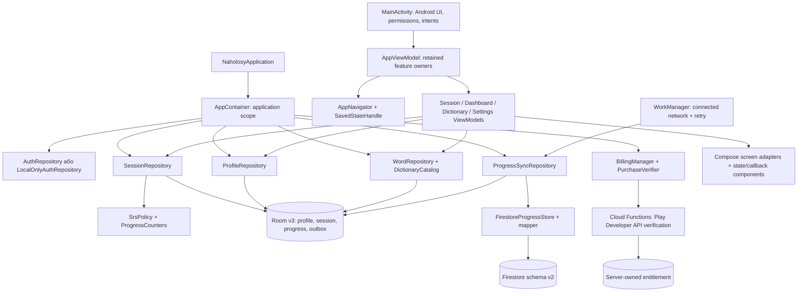
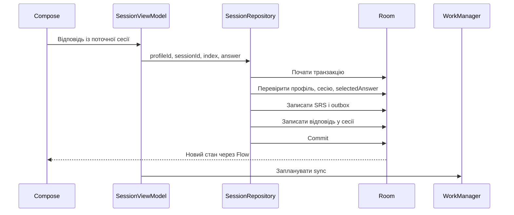

# Поточний System Design після змін

> Оновлення 8 листопада: серверні Functions/RTDN етапи цього документа історичні. Активна архітектура — [Firebase Spark + Play Billing на пристрої](spark-migration-2026-11-08.md); не розгортати старий backend у цьому режимі.

Оновлено: 28 жовтня 2026 року. Описує код у робочій директорії. Debug-компіляція, 49 JVM-тестів і 3 native тести на Android 15 пройшли; решта acceptance і production-передумов наведені в release-verification.md.

## Межі відповідальності

Ручний DI залишається явним: одна точка створення залежностей на процес, спільна для UI та worker. Hilt не є умовою цієї моделі. Навігація має збережений список маршрутів із обмеженим розміром, поверненням назад і відновленням через SavedStateHandle. Стан навчання живе в Room, а не в маршруті.

## Локальна відповідь

Ідентифікатор відповіді визначається парою `sessionId + currentIndex`. Уже прийнятий index не можна зарахувати повторно, навіть після створення нового репозиторію/процесу. `next` також перевіряє index і наявність відповіді. У режимі difficult сесія зберігається, а SRS навмисно не змінюється.

Черга coalesce-ить зміни одного слова. WorkManager працює після відновлення мережі, повторює невдалі спроби з backoff, має страховий запуск раз на 6 годин і окремий foreground trigger. Запити групуються початковою затримкою 15 секунд. KEEP може об'єднати одночасні запити; залишок черги спричиняє retry, а періодичний запуск закриває вікно між завершенням worker і новим записом.

## Профілі й гостьові дані

- `word_states` має складений ключ `(profileId, wordId)`; сесії, черга та sync metadata також мають profileId.
- Зміна акаунта перемикає видимий профіль, а попередні дані залишаються ізольованими локально.
- При вході гостьові відповіді переносяться в обраний акаунт і зливаються з його станом. Гостьова сесія переноситься, якщо в акаунті немає активної сесії. Якщо вона там є, гостьова сесія завершується як окремий UI-процес, але вже зарахований прогрес зберігається.
- Після перенесення гостьовий writerId змінюється. Нове гостьове навчання не починає старий лічильник із нуля під тим самим ключем.
- Перший sync прив'язує локальний профіль до поточного покоління хмари. Наступний вищий generation означає віддалене скидання й видаляє старі локальні дані цього профілю.
- Кеш Premium містить UID власника й діє лише для поточного Firebase-акаунта.

## Два пристрої

Лічильники мають map `writerId -> correct/wrong/lapses`. Merge бере максимум кожної компоненти одного writer і сумує різних writers. Writer складається з installation ID та локального writer ID профілю. Installation ID лежить у `noBackupFilesDir`; Android backup не копіює його на новий пристрій.

Розклад SRS — детермінований register: більша revision, потім updatedAt, потім deviceId. Merge не збільшує revision і не підставляє поточний час. Це забезпечує повторюваний результат для валідних версій, створених цим клієнтом. Водночас це **не відтворення хронології двох незалежних офлайн-сесій**: для одночасних відповідей обирається один розклад, тоді як обидві відповіді враховуються в лічильниках. Точну історію для старого v1 snapshot відновити неможливо; старі суми мігрують у спільну baseline-компоненту `legacy`.

Час повторення залишається локальним wall-clock часом. Зміна годинника телефону впливає на dueAt; revision має пріоритет над timestamp. Підтримується до 512 writer-компонент на слово; подальше ущільнення потребуватиме окремої версії протоколу.

## Синхронізація й reset

Cloud write виконує callable `syncWordProgress` (Auth + App Check). Сервер перевіряє каталог і кожен вкладений counter, читає root profile, rate-limit і документи слів у Firestore transaction; локальні rules забороняють прямі client word writes. Порядок deployment описано в [звіті про перехід](progress-server-cutover-2026-11-01.md). Усі читання виконуються перед записами. Generation і version перевіряються транзакційно. При застосуванні результату Room знову читає поточний локальний стан і виконує merge під локальною транзакцією: старий мережевий знімок не замінює нову відповідь.

Повне завантаження потрібне лише при відмінній cloud version. Після upload checkpoint підвищується лише якщо клієнт знає всі попередні версії. Одна транзакція містить до 20 слів і root metadata; це зменшує round trips, але кожен документ залишається окремою операцією обліку Firestore.

Reset — нове покоління, а не видалення документів по одному. UUID запиту зберігається локально до підтвердження. Незмінний `resetRequests/{requestId}` забезпечує ідемпотентність навіть якщо між спробами інший пристрій уже скинув прогрес. Старі epochs не читаються/не записуються клієнтом. Їх фізичне очищення — окрема серверна операція з політикою зберігання, а не автоматичне видалення в цьому клієнті.

Для signed-in reset потрібен зв'язок із сервером: запит зберігається й повторюється, а нові відповіді цього профілю блокуються до завершення. Guest reset виконується локально. Сесія, черга й нагадування очищаються разом із відповідним reset.

## Словник

Кожен JSON-запис має стабільний key, початково сумісний із v1 cloud hash. Після публікації key не змінюється при виправленні написання/наголосу. SHA-256 усього asset визначає оновлення каталогу; upsert зберігає Room IDs. Прибрані слова залишаються неактивними, щоб відновлювати старі сесії та не втрачати дані. UI й нагадування враховують активні слова.

При зміні каталогу треба виконати `python scripts/update-firestore-catalog.py`: allowlist правил зберігає також колишні ключі. При зміні правильного наголосу слід окремо визначати педагогічну політику повторного вивчення; поточний upsert зберігає прогрес. Старі клієнти не отримають новий asset без оновлення APK.

## Перевірки та межі

- Синтаксис Kotlin перевіряється окремим parser, SQL міграції — на SQLite у пам'яті.
- Firebase rules перевіряються реальними локальними Auth/Firestore Emulator REST-запитами.
- Сценарій навантаження емулятора не є benchmark production Firebase або Firebase SDK клієнта.
- Kotlin/Java/KSP debug compilation, 49 unit/Room/Compose тестів і 3 native device-тести пройшли. Реальне оновлення v2→v3 зберегло 80/80 записів прогресу. APK перевіряється також на відповідність merged DEX, бо локальний incremental packaging міг залишити старий код.
- Production-конфігурації, Play Console, доступ сервісного акаунта, App Check enforcement, реальні покупки та UI на пристроях потребують окремої перевірки перед публікацією.

Документація протоколів: [Firestore transactions](https://firebase.google.com/docs/firestore/manage-data/transactions), [Play purchase verification](https://developer.android.com/google/play/billing/security), [ProductPurchase fields](https://developers.google.com/android-publisher/api-ref/rest/v3/purchases.products).
