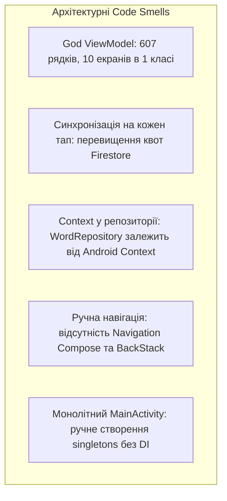
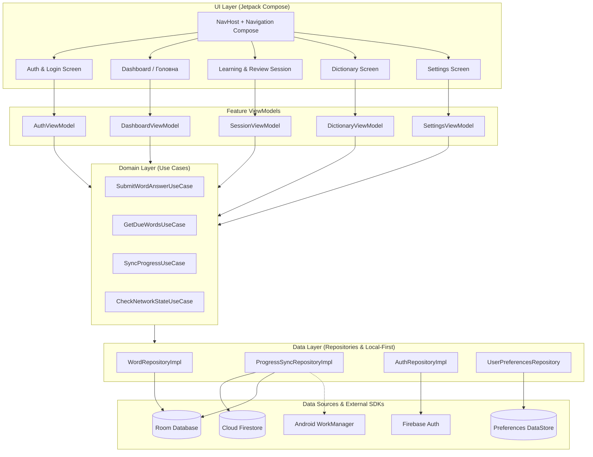
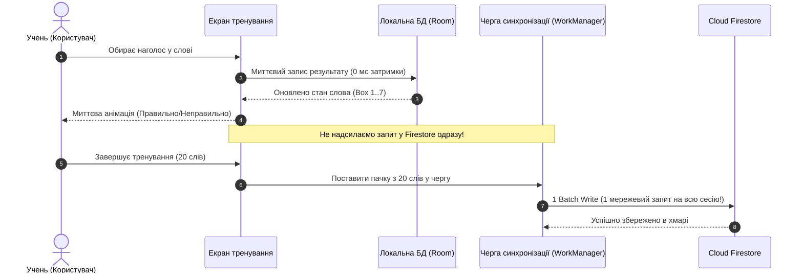

# System Design & Архітектурний аудит: «Інтервальні Наголоси»

**Дата аудиту:** Жовтень 2026 р.  
**Роль:** Senior Software Architect  
**Ціль:** Оцінка поточної архітектури, стрес-тест масштабованості (10 000+ користувачів), аналіз відображення на різних пристроях та план переходу до цільового масштабованого стану (Clean Architecture).

---

## 1. Executive Summary: Реальний стан готовності проєкту

* **Оцінка користувача:** ~80%
* **Оцінка архітектора:** **75–80%** за користувацьким функціоналом, проте **~45%** за рівнем готовності архітектури до високих навантажень та довгострокової підтримки.

### Матриця готовності підсистем:
| Підсистема | Готовність | Стан та зауваження |
| :--- | :---: | :--- |
| **Базова SRS-логіка (Лейтнер)** | **95%** | Чудова локальна реалізація в Room (7 коробок, таймінги, штрафи за помилки). |
| **Словник та UI (Jetpack Compose)** | **85%** | Повноцінний Material 3, темна/світла теми, адаптивність під планшети. |
| **Локальні сповіщення (WorkManager)** | **90%** | Розумний воркер, роздільні канали, коректні пермішени Android 13+. |
| **Аутентифікація (Google Credential Mgr)** | **70%** | Працює Google Sign-In, але немає Email/Password та обов'язкового Auth Gate. |
| **Хмарна синхронізація (Firestore)** | **65%** | Працює Local-First CRDT-злиття, але архітектурна помилка — транзакція на кожне слово. |
| **Архітектура коду (Clean / DI / Nav)** | **40%** | God ViewModel (600+ рядків), монолітний MainActivity, відсутній Hilt, ручна навігація. |

---

## 2. Аналіз поточного патерну та Data Flow

### 2.1. Поточний архітектурний патерн
Зараз у проєкті реалізовано **Simplified Monolithic MVVM (Монолітний MVVM без DI та без офіційного Jetpack Navigation)**:

```
[ Compose UI Screens (10 екранів) ]
               │ ▲
       Events  │ │ StateFlows (20+ потоків)
               ▼ │
       [ AppViewModel (God Class, 607 рядків) ]
               │
    ┌──────────┼───────────────┬────────────────┐
    ▼          ▼               ▼                ▼
[WordRepo] [AppPreferences] [AuthRepo] [ProgressSyncRepo]
    │          │               │                │
    ▼          ▼               ▼                ▼
 [Room DB] [DataStore]   [Firebase Auth]  [Cloud Firestore]
```

* **UI Layer:** Jetpack Compose, який безпосередньо звертається до єдиного велетенського `AppViewModel`.
* **State Management:** Понад 20 окремих `StateFlow` усередині `AppViewModel`. Будь-яка зміна (наприклад, введення літери в пошуку словника) призводить до перерахунку та оновлення стану всього додатка.
* **Navigation:** Відсутній `androidx.navigation:navigation-compose`. Екрани перемикаються через `when (currentScreen)` всередині `MainAppContent.kt`. Це позбавляє додаток стандартного Back Stack, безпечної передачі аргументів та збереження стану при смерті процесу (Process Death).
* **Dependency Injection:** Відсутній Hilt або Koin. Усі репозиторії, менеджери та бази створюються через `lazy` всередині `MainActivity.kt`.

### 2.2. Потік даних (Data Flow) під час відповіді на картку
1. Користувач тисне на варіант наголосу в `LearningSessionScreen`.
2. Викликається `AppViewModel.submitAnswer(answer)`.
3. Оновлюється стан сесії `_activeSession.value` (миттєвий відгук UI).
4. Оновлюється стан слова в локальній базі даних Room (`WordRepository.updateWordState`).
5. **Вузьке місце:** Одразу у фоні запускається `syncRepository.syncWord(uid, wordId)`, який здійснює **мережеву транзакцію у Firestore на кожне окреме слово**.

---

## 3. Стрес-тест масштабованості: Що станеться при 1 000 – 10 000+ користувачах?

### 3.1. Клієнтська сторона (Local-First перевага)
* **Вердикт:** **Витримає легко.**
* Завдяки тому, що словник завантажений локально в SQLite (Room), телефон користувача виконує 95% роботи автономно. Навіть якщо 50 000 людей відкриють застосунок одночасно в метро чи бомбосховищі, навантаження на їхні процесори не залежить одне від одного.

### 3.2. Аутентифікація при одночасному вході (Firebase Auth)
* **Вердикт:** **Витримає без проблем.**
* Firebase Authentication побудований на інфраструктурі Google Identity. Одночасний вхід 5 000–10 000 учнів під час шкільного уроку чи тестування не створить навантаження на сервери Google.

### 3.3. База даних (Cloud Firestore) — КРИТИЧНЕ ВУЗЬКЕ МІСЦЕ ⚠️
* **Модель даних:** Дані ізольовані за шляхом `users/{uid}/wordProgress/{wordKey}`. Це означає, що **конфліктів блокування між користувачами немає**.
* **АЛЕ: Ліміти квот і фінанси:**
  * У безкоштовному тарифі Firebase (Spark Plan) діють ліміти: **50 000 читань/день** та **20 000 записів/день**.
  * Оскільки зараз `syncWord` робить транзакцію (1 get + 1 set) на **кожне слово**:
    $$\text{1 учень} \times 20 \text{ слів на день} = 20 \text{ читань} + 20 \text{ записів}$$
    $$\text{1 000 учнів} = 20 000 \text{ записів} \implies \mathbf{100\%\ \text{квоти вичерпано за один день!}}$$
  * 1 001-й користувач отримає помилку `RESOURCE_EXHAUSTED` (квота вичерпана, синхронізація падає).
* **Мережева затримка (Network Churn):** У разі нестабільного зв'язку (LTE/3G) постійні мережеві транзакції після кожного тапу будуть накопичувати помилки та садити батарею.

---

## 4. Робота на різних пристроях та екранах

### 4.1. Що вже зроблено добре:
* Файл `AdaptiveLayout.kt` реалізує поділ на класи розмірів:
  * `Compact` (< 600dp) — стандартні смартфони.
  * `Medium` (600–840dp) — складні смартфони в розгорнутому вигляді (Fold), вертикальні планшети.
  * `Expanded` (> 840dp) — горизонтальні планшети, Chromebook.
* На великих екранах автоматично з'являється `SideNavigationRail` замість нижнього меню, а сітка карток розширюється до 2 колонок.
* Використовується `AdaptiveScreenContainer` з обмеженням максимальної ширини контенту (`Focused = 760dp`, `Wide = 1200dp`), тому кнопки не розтягуються безглуздо на весь екран 12-дюймового планшета.

### 4.2. Де криються ризики відображення:
1. **Низька висота екрана (Small/Landscape Phones):**
   * Екран проходження тесту або модальні вікна можуть обрізатися по висоті, якщо вони не обгорнуті у `Modifier.verticalScroll`.
2. **Системні Insets (Edge-to-Edge):**
   * `MainActivity` викликає `enableEdgeToEdge()`. Якщо десь у `Scaffold` не враховано `WindowInsets.safeDrawing`, елементи інтерфейсу можуть налазити на камеру-виріз («острівець») або системну смугу жестів навігації Android.

---

## 5. Реєстр Code Smells та критичних архітектурних помилок



1. **God ViewModel (`AppViewModel`):**
   * Керує одночасно: пошуком у словнику, сесією тренування, налаштуваннями звуку/вібро, перевіркою преміум-статусу, авторизацією, синхронізацією з хмарою та підрахунком серії.
   * *Наслідок:* Будь-яка зміна поля призводить до зайвих рекомпозицій Compose. Код важко тестувати юніт-тестами.
2. **Context Leak у `WordRepository`:**
   * У конструктор передається `context: Context` лише заради того, щоб відкрити `context.assets.open("words.json")`. Репозиторій має бути чистим від Android SDK.
3. **Відсутність Dependency Injection (Hilt):**
   * Усі залежності ініціалізуються в `MainActivity` через `lazy`. Якщо додається новий екран або сервіс, `MainActivity` розростається ще більше.
4. **Синхронізація «в лоб» замість Batch/Queue:**
   * Замість відправки прогресу пачкою після завершення сесії (`finishSession`), надсилається запит на кожне слово.

---

## 6. Target High-Level Architecture (Ідеальний цільовий стан)

### 6.1. Багаторівнева Clean Architecture



### 6.2. Оптимізована архітектура синхронізації (Smart Batching)



---

## 7. Roadmap: План завершення решти 20% проєкту

### Етап 1: Швидкі UX та функціональні правки (Поточний запит)
1. **Перейменування вкладки:** Змінити "Панель" на "Головна" у `BottomNavigationBar`, `SideNavigationRail` та заголовках.
2. **Повне видалення серії та вогника:**
   * Видалити `StreakCard` з `DashboardScreen`.
   * Прибрати згадки про серію днів з `OnboardingScreen` (3-й слайд).
   * Очистити логіку `updateStreak()` та ключі `currentStreak` з `AppViewModel` і `AppPreferences`.
3. **Mandatory Auth Gate (Примусовий вхід):**
   * Створити `AuthGateScreen` одразу після онбордингу без можливості пропуску.
   * Підтримка швидкого входу через Google (та за потреби Email/Password).
4. **Internet Blocker (Перевірка підключення):**
   * Додати `NetworkMonitor` (через Android `ConnectivityManager`).
   * Якщо під час старту немає інтернету протягом 5–10 секунд — показувати центральне діалогове вікно: *«Упс... Здається, підключення до інтернету відсутнє (:»* із кнопкою «Спробувати знову».

### Етап 2: Оптимізація бекенду та синхронізації
1. **Пакетна синхронізація Firestore:**
   * Замінити поодинокі виклики `syncWord` на відправку результатів сесії пачкою (`commitBatches`) під час виклику `finishSession()`.
   * Це скоротить витрати квот Firestore у 20–50 разів і захистить від блокування лімітів.
2. **Локальні vs Серверні сповіщення:**
   * Залишити розрахунок повторень у `ReviewReminderWorker` (локально на телефоні). Серверні сповіщення без окремого платного бекенду (Cloud Functions на Blaze) не матимуть переваг, а локальні працюють гарантовано та безкоштовно.

### Етап 3: Архітектурний рефакторинг (Підготовка до 100 000+ користувачів)
1. **Декомпозиція God ViewModel:**
   * Розбити `AppViewModel` на спеціалізовані моделі: `MainDashboardViewModel`, `PracticeSessionViewModel`, `DictionaryViewModel`, `SettingsViewModel`, `AuthViewModel`.
2. **Впровадження Hilt:**
   * Додати анотації `@HiltAndroidApp`, `@AndroidEntryPoint`, `@Inject` для усунення важкого `MainActivity`.
3. **Перехід на Navigation Compose:**
   * Стандартизувати переходи між екранами з підтримкою збереження стану при перевертанні екрана та відновленні процесу.
