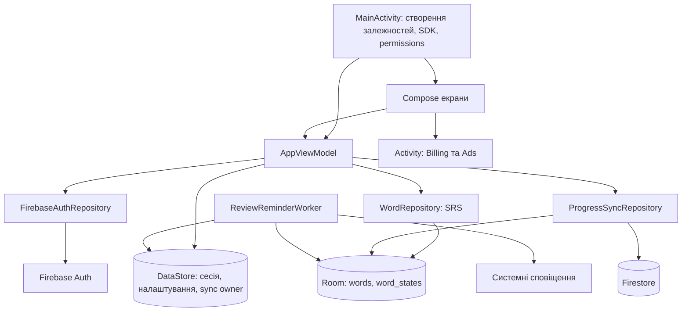
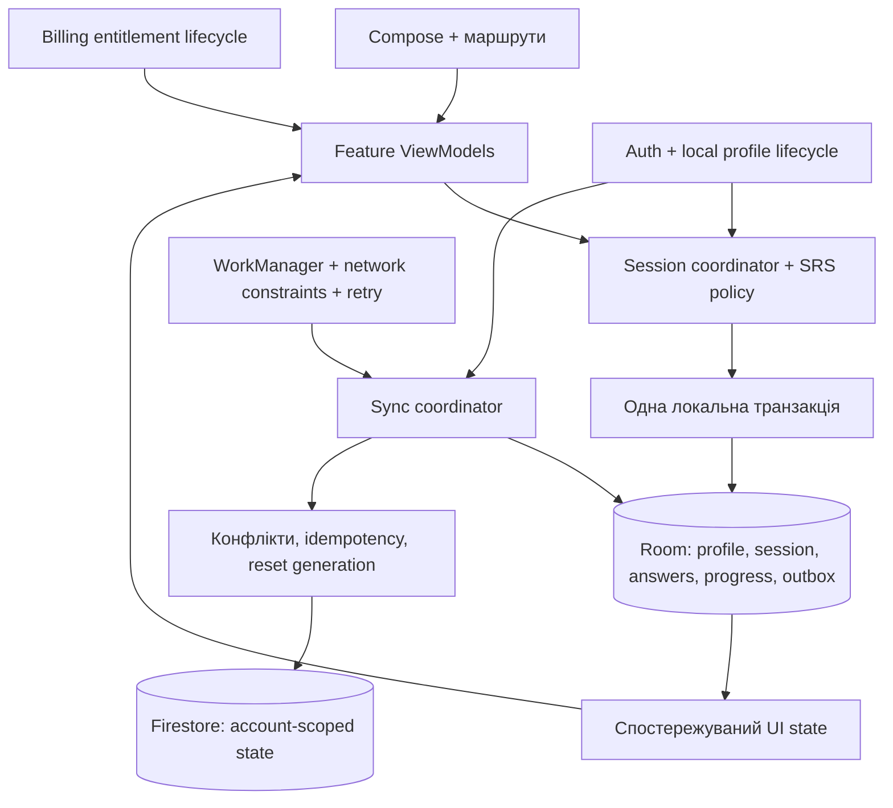

# Повторний архітектурний аудит «Інтервальні Наголоси»

Дата: 21 жовтня 2026 року. Перевірено поточну робочу копію та `my_project_system_design.md`.

## Висновок

Основа застосунку доречна для цього продукту: одне Android-застосування, Compose, MVVM із репозиторіями, локальна Room, DataStore та Firebase як керований бекенд. У ньому 233 словникові записи. Саме число встановлень не збільшує обсяг локальної бази кожного телефону. Переписування на мікросервіси не випливає з поточних потреб.

Попередній звіт правильно помітив концентрацію відповідальності в AppViewModel, ручну навігацію, витрати синхронізації та ризики малих екранів. Але він пропустив суттєві помилки збереження й узгодження даних, містить неправильну економіку batch-записів і надто впевнені твердження про масштабованість. Його відсотки готовності не мають вимірюваної основи.

Це статичний аудит із перевіркою конфігурації та спробою запуску наявних тестів, а не навантажувальний тест Firebase чи сертифікація роботи на пристроях. Сценарії гонок нижче виведено з порядку операцій у коді; їх слід закріпити інтеграційними тестами. Налаштування живої Firebase Console, тариф, реально розгорнуті правила, квоти та стан Play Console не перевірялися.

## 1. Поточна архітектура і потоки

Один Gradle-модуль `app`, minSdk 24, targetSdk 36. MainActivity створює залежності вручну й передає їх через AppViewModelFactory. Це **ручний constructor dependency injection**, а не повна відсутність DI. Domain-логіка SRS міститься в WordRepository; мережевий sync окремий, але напряму змінює ту саму Room.

Відповідь: UI → `submitAnswer` → стан UI → coroutine → streak у DataStore → SRS у Room → мережевий `syncWord` → збереження сесії в DataStore. Для режиму `difficult` SRS та sync навмисно пропускаються (`sessionUpdatesSrs`). Отже, твердження «транзакція після кожного тапу» надто широке.

Вхід / запуск із збереженим акаунтом: Auth StateFlow → `syncNow` → читання профілю і всієї колекції прогресу із сервера → merge → batch-записи змінених документів → безумовне застосування знімка до Room → збереження owner UID. Повна синхронізація вже використовує batch.

## 2. Пропущені проблеми за пріоритетом

### P1 — 1. Повна синхронізація може затерти щойно дану відповідь

Доказ: `ProgressSyncRepository.kt`, `performFullSync`, зокрема читання `statesDeferred`, формування `statesToApply` і наступний `applySyncedWordStates`; `WordDao.kt`, вставка з `REPLACE`.

Сценарій: sync прочитав локальну revision 4 → користувач відповів, Room уже має revision 5 → sync завершив мережу й записав свій старий знімок revision 4. Відповідь втрачається. Mutex у sync-репозиторії серіалізує лише sync-операції, не `WordRepository.updateWordState`. Наступний `syncWord` читає вже перезаписану Room.

Окремо full sync виконує cloud read → обчислення → batch set без перевірки версії. Інший пристрій може записати новішу версію між read і set, і batch затре її. Транзакції в `syncWord` не захищають від цього шляху.

Потрібно: атомарне локальне merge із повторним читанням поточного стану/перевіркою revision та протокол конкурентних cloud-змін. Не утримувати Room-транзакцію протягом мережевого запиту.

### P1 — 2. Room-прогрес і стан сесії не зберігаються атомарно

Доказ: `AppViewModel.kt:366`, `submitAnswer`; `persistActiveSession` викликається після очікування sync.

Сценарій: відповідь уже в Room → інтернет завис → процес завершився до запису DataStore. Після відновлення та сама картка ще не має selectedAnswer; користувач відповідає повторно, збільшуючи лічильник удруге. Інший можливий порядок — `nextQuestion` зберіг новий індекс, поки coroutine відповіді ще не встигла записати Room. UI змінюється раніше за гарантоване локальне збереження.

Потрібно: унікальний answer/event ID, атомарний запис відповіді, стану сесії й завдання синхронізації в одній локальній БД. Саме перенесення sync у `finishSession` не вирішує цю проблему.

### P1 — 3. Timeout залишає синхронізацію у стані Syncing

Доказ: `ProgressSyncRepository.kt`, усі `withTimeout(30_000)` та `catch (CancellationException) { throw exception }`; `SettingsScreen.kt`, кнопка sync вимкнена для Syncing.

TimeoutCancellationException успадковує CancellationException. Власний мережевий timeout обходить обробку Error. Для `submitAnswer` він також перериває шлях до `persistActiveSession`. В auth collector timeout із `syncNow` може завершити coroutine збору authState, залишивши її без подальших оновлень.

Потрібно відрізняти внутрішній timeout запиту від зовнішнього скасування роботи та гарантовано завершувати стан Syncing. Обгортки `awaitValue`/`awaitCompletion` не скасовують Firebase Task: після timeout віддалений запис ще може завершитися. Повторення операцій має бути ідемпотентним.

### P1 — 4. Видалений прогрес може повернутися з іншого пристрою

Доказ: `ProgressSyncRepository.clearProgress` фізично видаляє документи; `mergeProgress(local, null)` повертає local; full sync об'єднує локальні та хмарні ключі.

Пристрій А скидає прогрес → пристрій Б зі старою локальною копією синхронізується → відсутні документи створюються знову. Немає reset generation / tombstone, які повідомили б Б про скидання.

Додатково `AppViewModel.clearAllProgress` не прибирає активну/збережену сесію, streak і snapshot нагадувань. Після скидання можна продовжити стару сесію. Видалення декількома batch не є атомарним між batch.

Потрібно визначити обсяг reset, ввести покоління прогресу, узгодити його на всіх пристроях та очистити пов'язані локальні стани.

### P1 — 5. «CRDT-злиття» не забезпечує точний облік відповідей

Доказ: `ProgressSyncModels.kt`, `mergeProgress`: вибір за revision/time/device та `max` лічильників.

Обидва пристрої мають correctCount=5. Кожен офлайн правильно відповідає один раз: обидва отримують 6. Merge повертає 6, хоча відповідей стало 7. max зберігає найбільше значення, але не незалежні події. Підвищення revision під час merge і параметри `now`/`localDeviceId` також потребують перевірки властивостей збіжності; називати це доведеним CRDT не можна.

`deviceId` не зберігається в WordState: після завантаження в Room інформація про автора версії втрачається; `toCloudProgress` присвоює поточний installId. Це змінює tie-breaker при повторній синхронізації однакового стану. Час береться з годинника телефону.

Потрібна явна продуктова семантика двох офлайн-пристроїв: допустимий приблизний snapshot чи точні події. Для точності — ідемпотентні events або лічильники по пристроях із чітким правилом SRS-конфліктів. Зарезервовані `reviewEvents` у rules ще не означають реалізований event log.

### P1 — 6. Обхід оплати доступний у release-коді

Доказ: `SettingsScreen.kt:608` — п'ять натискань викликають `onDevToggle`; `AppViewModel.kt:540` без перевірки debug викликає `setPremium`.

Немає `BuildConfig.DEBUG` чи окремого debug source set для цього шляху. Користувач може вимкнути рекламу без покупки. Для публічного платного продукту це прямий блокер.

BillingManager також лише встановлює Premium=true при знайденій покупці: після успішного запиту без активної покупки він не скидає старе значення. Результат acknowledge ігнорується, серверної перевірки покупки в цьому проєкті немає. Ціна UI жорстко задана як 29 грн, хоча `getPriceString` існує. При відсутньому productDetails натискання покупки мовчки нічого не робить.

### P2 — 7. Немає стійкої черги синхронізації

Sync запускається з viewModelScope; WorkManager використано тільки для нагадувань. Немає dirty/outbox записів, збереженого retry/backoff і автоматичного sync при відновленні мережі. Втрата coroutine не стирає вже записану Room, але немає гарантованого автоматичного доправлення прогресу в хмару без нового запуску/ручної спроби/подальших відповідей.

Навіть успішний `syncWord` виставляє `Synced.wordCount` за кількістю **локальних** станів, а UI називає це кількістю слів у хмарі. Після попередніх невдалих відправлень повідомлення може бути неправдивим.

Потрібно відображати pending/failed/last successful sync на основі реально підтверджених записів. Черга має формуватися при локальному записі відповіді, а не тільки наприкінці тренування.

### P2 — 8. Локальний профіль не ізольований за акаунтами

WordState має ключ wordId без UID. DataStore містить один `sync_owner_uid`, одну сесію та глобальні лічильники. Sign-out не очищає і не перемикає їх. При вході в Б після А sync отримує AccountMismatch; користувач Б усе одно бачить локальну копію А. Це не дозвіл Б читати хмару А: rules коректно обмежують UID.

Потрібен свідомий вибір: один акаунт на інсталяцію з керованим очищенням/експортом або окремі локальні профілі. Потрібні правила перенесення guest-прогресу. Автоматичні операції попереднього акаунта мають перевіряти актуальне покоління профілю перед локальним apply.

### P2 — 9. Лічильник слів до повторення застаріває без змін БД

`AppViewModel.updateStats` використовує поточний час, але викликається лише при emission `allWordStates`. Якщо dueAt настав, поки користувач залишався у застосунку, Room не змінюється і лічильник залишається старим. Перехід між екранами сам по собі не гарантує перерахунок. ProgressStats/DifficultWords мають хвилинний ticker, Dashboard — ні.

Потрібно об'єднати стан БД із часом/оновленням при resume; протестувати перехід через dueAt та північ. Streak аналогічно перераховується лише при відповіді.

### P2 — 10. Оновлення словника для наявних користувачів не реалізоване

`seedDatabaseIfEmpty` завантажує words.json тільки якщо таблиця порожня. Оновлення APK із виправленим наголосом або новими словами не змінить словник старої інсталяції. Помилка початкового завантаження лише друкується, після чого ViewModel усе одно виставляє isSeeded=true.

Потрібні версія словника, upsert/міграція та відновлюваний стан помилки. Cloud key залежить від normalized і stressPositions: виправлення цих полів потребує правила перенесення прогресу. Room migration 1→2 є, але exportSchema=false, міграційних тестів немає.

### P2 — 11. Справжній витік Activity через довгоживу ViewModel

`MainActivity.kt:60` передає `this` у WordRepository; AppViewModel зберігає цей репозиторій і переживає configuration change. Старий Activity залишається доступним через ViewModel → repository → context.

Попередній звіт назвав це Context Leak, але пояснив лише небажаністю Android-залежності. Реальна причина — **Activity context у довгоживучому об'єкті**, а не будь-який Context. Мінімальне виправлення — applicationContext/окреме джерело assets. Hilt для цього не обов'язковий.

### P2 — 12. Адаптивність є, але екран навчання реально обмежений висотою

`LearningSessionScreen.kt:257` — непрокручувана зовнішня Column; середина з weight(1f); усі варіанти відповіді в Column; кнопки height(56.dp), проміжки 14.dp, картка слова має значні padding. У поточному словнику є слова з 6 голосними: тільки шість кнопок із проміжками потребують 406dp, без слова, header та feedback.

Це конкретний ризик недоступних відповідей на landscape/малих вікнах і при великому системному шрифті, а не просто загальна порада «можливо додати scroll». `PracticeSetupScreen` і `SessionFinishedScreen` уже прокручуються.

Інші місця: PracticeSetup має фіксований ряд 3×84dp + 2×16dp = 284dp при зовнішніх 24dp з кожного боку — для вікна 320dp доступно лише 272dp. ProgressStats поєднує коло 180dp з двома кнопками 48dp та padding, що також потребує перевірки вузьких вікон. SideNavigationRail орієнтується тільки на ширину й не прокручується; широка, але низька область може бути проблемною.

Немає обробки hinge/posture foldable. `Scaffold` уже передає innerPadding: відсутність буквального safeDrawing не доводить загальне перекриття системними панелями. Початковий onboarding рендериться поза Scaffold — його insets слід перевірити окремо.

Словник показує наголос лише кольором/жирністю малих літер (`formatStressedWord`), без окремої семантики позиції наголосу для TalkBack. Потрібна перевірка доступності навчальної інформації, а не лише видимості кнопок.

### P2 — 13. Release-конфігурація та захист від зловживань не завершені

App Check dependency є, але встановлення provider у коді не знайдено. Документ firebase-schema прямо каже, що enforcement вимкнений у dev; живий стан Console невідомий. Rules добре перевіряють ownership, поля й типи, але не ставлять квоту кількості документів власника і не звіряють wordKey зі словником. Це ризик витрат від авторизованого зловживання, а не доступ до чужих даних. App Check сам по собі не є повноцінним rate limiter.

AdMob використовує тестові ID. Немає явного поділу dev/prod через flavors у Gradle; документація вимагає окрему production-конфігурацію. README містить інший applicationId, ніж фактичний `com.intervalninaholosy.nmt`.

Відсутній google-services.json допускається збіркою, але AuthRepository і Firestore безумовно викликають getInstance. Тому без конфігурації не гарантований навіть локальний старт, попри no-op fallback у telemetry. Треба узгодити конфігураційні вимоги або забезпечити справжній guest-only fallback.

### P2 — 14. Backup/restore не узгоджено із sync identity

allowBackup=true, backup XML залишено шаблонним, sync_install_id і sync_owner_uid зберігаються у DataStore без спеціальних виключень. Перенесення даних може скопіювати installId на інший пристрій, а це підриває припущення про унікальність deviceId у merge. Слід явно визначити, які дані відновлюються, як генерується нова device identity та як звіряється owner після restore.

### P2 — 15. Тести не підтверджують заявлену готовність

Є корисні unit-тести merge, допоміжних SRS-функцій, notification policy та breakpoint-функцій. Але немає тестів WordRepository.updateWordState, Room migration, процесної смерті, account switch, гонок sync/answer/reset та реального UI на різних розмірах. Screenshot test рендерить лише Hello Robolectric, не екрани продукту. Instrumentation test очікує package `com.example`, що не відповідає applicationId.

Rules script перевіряє базові заборони доступу й один некоректний box; він не моделює всю синхронізацію. Наявність Crashlytics/Analytics корисна, але немає метрик backlog, тривалості sync, stale progress та частоти помилок по типах.

### Інші спостереження нижчого пріоритету

- BillingClient створюється при кожному onCreate, але `endConnection` відсутній. Scope прив'язаний до Activity, життєвий цикл SDK потребує впорядкування.
- SoundFeedbackManager має власний SupervisorJob, але release() порожній; синтез повторюється для кожного звуку. Потрібне коректне завершення та профілювання на слабких пристроях, а не припущення про високу вартість без вимірів.
- AppDatabase singleton не перевіряє INSTANCE повторно всередині synchronized: два одночасні перші виклики теоретично створять два екземпляри.
- `startPractice` може замінити незавершену сесію, на відміну від startReview/startDifficultPractice. Потрібно визначити бажану поведінку.
- `collectAsState` не прив'язує збирання до STARTED lifecycle. Це окреме питання фонового споживання, а не доказ рекомпозиції всього UI.
- Назва InterFontFamily у Type.kt приховує FontFamily.SansSerif; bundled inter_regular.ttf не підключено. Вигляд шрифту залежить від системного сімейства.

## 3. Помилки та перебільшення попереднього звіту

| Твердження | Уточнення |
|---|---|
| Batch скорочує квоту в 20–50 разів | 20 set у batch залишаються 20 document writes. Економія можлива від усунення повторних записів одного слова, зайвих читань і запитів, а не від упаковки різних документів. |
| Firebase Auth витримає одночасний вхід без проблем | Потрібно перевірити тариф/Identity Platform, квоти, first-login registration, спільний IP і latency; гарантії в коді немає. |
| Кожна зміна StateFlow оновлює весь застосунок | Оновлюються читачі конкретного стану; пошук включений у dictionaryWords, не в усі потоки. Потрібні заміри recomposition. |
| Немає DI | Є ручний constructor injection і factory; немає DI-фреймворку та впорядкованих application scopes. |
| Немає відновлення після process death | ActiveSession уже серіалізується в DataStore і відновлюється; проблема — узгодженість записів. Поточний маршрут/історія повністю не відновлюються. |
| Navigation Compose вирішить збереження стану | Навігація допомагає з маршрутами, але не забезпечує атомарність прогресу/сесії й не зберігає довільний бізнес-стан автоматично. |
| Немає batching | commitBatches уже застосовано для full sync. |
| Локальні сповіщення гарантовані | WorkManager допускає затримки від OS/Doze. У коді період 20 хв і grace 5 хв, це не точний таймер. |
| 75–80% функціоналу / 45% production | Немає вимог, критеріїв приймання, знаменника, coverage чи навантажувальних вимірів для цих чисел. |
| Auth Gate, Internet Blocker, видалення streak — поточний запит | Цих продуктових вимог у наданому запиті немає. Блокування без інтернету змінює offline-first поведінку; це окреме рішення користувача. |

Облік Firestore підтверджує [офіційна документація billing](https://firebase.google.com/docs/firestore/pricing). Обмеження точності periodic work — [Android WorkManager](https://developer.android.com/develop/background-work/background-tasks/persistent/getting-started/define-work).

## 4. Кілька тисяч користувачів: коректніший розрахунок

Нижче модель, не результати benchmark. Позначимо U — активні користувачі, L — кількість повних sync за день, P — кількість cloud wordProgress документів користувача, A — відповіді, що змінюють SRS.

За стабільного owner і без повторів транзакцій приблизно:

- Reads ≈ U × [L × (P + 1) + A], якщо P > 0; порожній query теж має мінімальну плату читання.
- Writes ≈ U × [L × (1 + D) + A], де D — кількість відмінних snapshot-документів full sync. D може бути ненульовим через конфлікти/переприсвоєння deviceId.
- Reset додає читання і deletes; retries та первинний імпорт додають операції. Це не повний розрахунок рахунку зі storage/network.

При U=1000, L=1, P=100, A=20, D=0: близько **121 000 читань і 21 000 записів за день**. При 5000 одночасних повних sync з P=100: близько **505 000 читань** тільки для стартової синхронізації. Це оцінка кількості операцій, не твердження про їхню пропускну здатність чи час виконання.

Безкоштовні квоти 50 000 reads і 20 000 writes/day підтверджені документацією Firestore. Неможливо визначити конкретного «1001-го користувача», якому відмовлять: квоту спільно споживають усі операції. На платному тарифі це також питання бюджету й моніторингу.

Auth має окремі обмеження. [Firebase Auth limits](https://firebase.google.com/docs/auth/limits) вказує 100 створень акаунтів/годину на IP і окремо 3000 Tier-1 DAU для **Authentication with Identity Platform на Spark**. Останнє не слід автоматично переносити на кожен Firebase Auth-проєкт. Масовий перший вхід зі шкільної мережі треба перевіряти окремо від повторного входу зареєстрованих користувачів.

Висновок: локальне навчання не має спільного сервера обчислень; cloud-схема з різними UID має добру основу. Але для тисяч активних користувачів потрібні розрахований тариф, зменшення full sync, надійний протокол і контрольований тест на окремому середовищі. Сам Hilt або поділ ViewModel не збільшить хмарні квоти.

## 5. Цільова архітектура без зайвого переписування

Це концептуальна ціль; точну схему events/snapshots слід обрати після визначення вимог до двох офлайн-пристроїв. Для 233 слів допустимо залишити snapshot-модель, якщо її конфлікти, видалення та retry формально визначені. Не потрібно автоматично впроваджувати весь event sourcing.

Порядок робіт:

1. Усунути P1: гонки, неатомарне збереження, timeout, reset та release Premium toggle.
2. Зафіксувати семантику профілю, guest migration, двох пристроїв, backup та точності лічильників.
3. Реалізувати локальну outbox і стійке відправлення, pending/error UI, перевірки версій. Batching застосовувати разом із протоколом конфліктів.
4. Виправити компактний/landscape UI, тестувати великий шрифт і TalkBack.
5. Налагодити production-конфігурації, покупки, deployment rules, спостереження й бюджет.
6. Розділити AppViewModel за функціями та винести application-scoped залежності. Hilt/Navigation Compose — інструменти підтримки; їх можна вводити поступово.

Потрібні acceptance-сценарії: answer + sync одночасно; kill process після кожного етапу збереження; timeout та відновлення мережі; дві офлайн-відповіді на слово; reset на А при офлайн-Б; sign-out/account switch під час sync; upgrade dictionary; restore backup; успішна/відкликана/незавершена покупка; 320dp, landscape, tablet, split-screen, fontScale 1.0/1.3/2.0. Для навантаження вимірювати login та sync p50/p95/p99, частоту помилок, backlog і document operations на користувача.

## 6. Покриття повторного огляду

Оглянуто всі 47 production Kotlin-файлів за пакетами, без оголошення перевірки ресурсів візуальним тестом:

| Блок | Файли / відповідальності |
|---|---|
| Entry | MainActivity |
| Data | AppDatabase, AppPreferences/ThemeMode/PersistedSession, MoshiWord, ReviewStage, Word, WordDao, WordRepository, WordState |
| Presentation | AppViewModel, Screen, ActiveSession, AppViewModelFactory, MainAppContent |
| Auth/sync | AuthRepository/FirebaseAuthRepository/AuthAccount/AuthUiState, GoogleSignInCoordinator/GoogleSignInResult, ProgressSyncRepository, ProgressSyncModels/CloudWordProgress/ProgressSyncState |
| SDK | BillingManager, AdManager, AppTelemetry/FirebaseTelemetry/NoOpTelemetry |
| Reminders | Notifications, Policy/Decision, RescheduleReceiver, Scheduler, Worker |
| UI screens | Dashboard, Dictionary, DifficultWords, LearningSession, Onboarding/OnboardingPage, PracticeSetup, ProgressStats/ProgressSlide, SessionFinished, Settings |
| UI components | BrandingHeroBanner, ProgressCircle, QuickAccessItem, RepetitionStatusCard, WordItemRow |
| Adaptive/navigation | AdaptiveLayout/size classes, BottomNavigationBar, SideNavigationRail |
| Theme | Color, SemanticColors/AppTheme, Theme, Type |
| Utilities | LearningProgressUtils, StressUtils, SoundFeedbackManager/IqBand; embedded audio payload не оцінювався на слух |

Також перевірено Gradle/config/Manifest/backup XML, словник JSON, Firestore rules/indexes/schema, rules test script і всі наявні Kotlin test-файли. Бінарні ресурси та історичні design specs не вважалися доказом поточного runtime-поведінки. Відсутність тестів у цій копії не доводить, що ручного тестування ніколи не було.

Запуск `gradlew.bat :app:testDebugUnitTest --offline` не дійшов до виконання тестів: у локальному кеші відсутній `com.android.tools.build:aapt2:9.1.1-14792394` для Windows. Початкове обмеження доступу до Gradle cache було подолано дозволеним повторним запуском; фінальний блокер — відсутній offline artifact. Це не падіння assertion і не підтвердження успішності тестів. Firebase Emulator, навантажувальні та device/UI тести в цьому аудиті не запускалися. Код застосунку не змінено; додано тільки цей окремий звіт.
